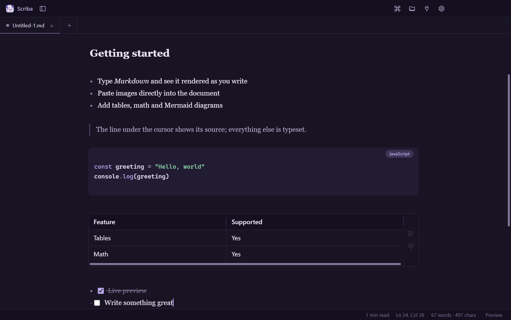

<div align="center">


# Scriba

**An open-source, plugin-driven WYSIWYG Markdown editor**

Markdown syntax hides behind the typeset result: the line under the cursor shows its source, everything else renders as it will look.

[](https://github.com/hui139/scriba/actions/workflows/ci.yml)
[](https://github.com/hui139/scriba/releases/latest)
[](LICENSE)
[](#download)

[English](README.en.md) · [简体中文](README.md) · [Docs](#documentation) · [Plugin API](docs/PLUGIN_API.en.md) · [Contributing](CONTRIBUTING.md)

</div>



## Download

<div align="center">

[](https://github.com/hui139/scriba/releases/latest)

**[⬇ Get the latest release](https://github.com/hui139/scriba/releases/latest)**

</div>

Every version and past installer: [releases](https://github.com/hui139/scriba/releases)

| Platform | File | Install |
| --- | --- | --- |
| **Windows** 10/11 (x64) | [`Scriba-<version>-win-x64.exe`](https://github.com/hui139/scriba/releases/latest) | Run the installer |
| **macOS** (Apple Silicon) | [`Scriba-<version>-mac-arm64.dmg`](https://github.com/hui139/scriba/releases/latest) | Open, drag Scriba into Applications |
| **macOS** (Intel) | [`Scriba-<version>-mac-x64.dmg`](https://github.com/hui139/scriba/releases/latest) | Same |
| **Linux** (x64) | [`Scriba-<version>-linux-x86_64.AppImage`](https://github.com/hui139/scriba/releases/latest) | `chmod +x`, then run |

> **The installers are not code-signed**, so the OS will warn on first launch:
>
> - **Windows**: SmartScreen shows "Windows protected your PC" → More info → Run anyway.
> - **macOS**: "Cannot verify the developer" → allow it under System Settings → Privacy & Security, or right-click the app and choose Open.
> - **Linux**: `chmod +x` the AppImage first.
>
> Installers are built from this repository's source by GitHub Actions — see [release.yml](.github/workflows/release.yml) — so you can verify the process or build from source yourself.

## Features

**Writing**

- Headings, bold, italic, strikethrough, highlight, underline, super/subscript, inline code, links, images, quotes, lists, task lists, rules, footnotes, `[TOC]` and YAML front matter all render inline as you type
- Editable tables: add rows and columns, set alignment from a context menu, drag column edges to resize (double-click to reset)
- Paste or drop screenshots and image files; they are saved into `assets/` and linked automatically, with `=200x` size syntax
- Lists continue on Enter, markers delete on Backspace, selected text becomes a link when a URL is pasted
- Workspace-wide search, outline sidebar, tabs, recent files, source mode
- Find and replace with case sensitivity, whole word, regular expressions and replace-all
- Focus mode and typewriter mode

**Typesetting and export**

- KaTeX math (`$...$`, `$$...$$`) and Mermaid diagrams render live
- Export to HTML, PDF, Word, plain text, PNG, LaTeX and EPUB (multi-level table of contents from headings)
- Relative image paths are inlined on export; EPUB packs the images into the archive
- Folder export copies Markdown and image assets together
- Export style templates: drop CSS into `<userData>/export-templates/`

**Personalisation**

- Six built-in themes (Violet Night by default, drawn from the app icon), plus user CSS and plugin themes
- Interface scale from 85% to 140%, with a separate document font size
- Every shortcut is rebindable; conflicts release the previous binding
- Interface languages: English and Simplified Chinese; plugins can add more

**Extensibility**

- JavaScript plugins can register commands, keybindings, status bar items, sidebar panels, code block renderers, themes and languages
- The plugin marketplace discovers plugins through the GitHub `scriba-plugin` topic — no central index required

## Build from source

Requires **Node.js 20+** and npm 10+.

```bash
git clone https://github.com/hui139/scriba.git
cd scriba
npm ci
npm run dev
```

| Command | Purpose |
| --- | --- |
| `npm run dev` | Development mode with hot reload |
| `npm run build` | Build into `out/` |
| `npm run typecheck` | TypeScript type check |
| `npm test` | All tests (unit + UI smoke) |
| `npm run test:compat` | Unit tests: version compatibility and manifest localisation |
| `npm run smoke` | UI smoke test driving the real app |
| `npm run dist` | Package an installer for the current platform into `release/` |
| `npm run icons` | Regenerate every icon from the source artwork |

<details>
<summary>Slow dependency downloads in mainland China</summary>

```bash
npm install --registry=https://registry.npmmirror.com

# PowerShell: route the Electron binary through a mirror
$env:ELECTRON_MIRROR="https://npmmirror.com/mirrors/electron/"
npm install --registry=https://registry.npmmirror.com
```

A `libpng warning: iCCP: known incorrect sRGB profile` line at startup comes from the Chromium bundled with Electron, not from this app or its icons, and does not affect functionality. Set `SCRIBA_SHOW_ELECTRON_WARNINGS=1` to see unfiltered output.

</details>

## Documentation

| Document | Contents |
| --- | --- |
| [Project overview](docs/PROJECT.en.md) · [中文](docs/PROJECT.md) | Design decisions, architecture and internals |
| [Plugin API](docs/PLUGIN_API.en.md) · [中文](docs/PLUGIN_API.md) | Full plugin interface reference with examples |
| [Plugin spec](docs/PLUGIN_SPEC.md) | Naming, manifest, publishing and validation rules (Chinese) |
| [Marketplace](docs/MARKETPLACE.md) | GitHub search and JSON index distribution (Chinese) |
| [Contributing](CONTRIBUTING.md) | Development workflow and commit conventions (Chinese) |

## Plugins

A plugin lives in `<userData>/plugins/<plugin-id>/` and contains a `manifest.json` plus a CommonJS entry exporting `activate(scriba)`:

```js
module.exports.activate = (scriba) => {
  scriba.commands.register({
    id: 'my-plugin.hello',
    name: 'Say Hello',
    run: () => scriba.ui.showToast('Hello from my plugin!')
  })
}
```

See [docs/PLUGIN_API.en.md](docs/PLUGIN_API.en.md) for the full API. Enable, disable and install plugins from the **Plugin Manager** inside the app.

Plugins are also discoverable: add the `scriba-plugin` topic to a public repository and it appears in the in-app marketplace. Requirements are in [docs/PLUGIN_SPEC.md](docs/PLUGIN_SPEC.md).

## Project layout

```
src/
  main/             Electron main process (windows, filesystem, plugins, export, updates)
  preload/          contextBridge API
  renderer/         React renderer
    src/editor/     CodeMirror editor and live preview
    src/plugins/    Plugin runtime and contribution registry
    src/components/ UI components
    src/markdown/   Markdown to HTML for export
plugins/            Built-in plugins (reading time, code language labels)
scripts/            Launchers, icon build, tests
docs/               Documentation
```

## Security

Plugins are ordinary JavaScript running in the renderer with the same privileges as the editor, so **only install plugins you trust**. Context isolation is enabled and the content security policy excludes `unsafe-eval`; plugin entries load through a Blob module, requiring only `script-src blob:`.

Plugins are currently neither signed nor sandboxed — a known limitation, documented in [docs/PLUGIN_SPEC.md](docs/PLUGIN_SPEC.md#九已知限制).

## Roadmap

- [ ] Version history
- [ ] Collaboration and cloud sync (optional)

Shipped features are listed in [Releases](https://github.com/hui139/scriba/releases) and the commit history.

## Contributing

Issues and pull requests are welcome. Read [CONTRIBUTING.md](CONTRIBUTING.md) first, and make sure `npm run typecheck`, `npm test` and `npm run build` pass. CI runs those checks on Windows, macOS and Linux.

## License

[MIT](LICENSE) © Scriba Contributors

The app icon is project-specific artwork, owned by its author and not covered by the MIT licence.
